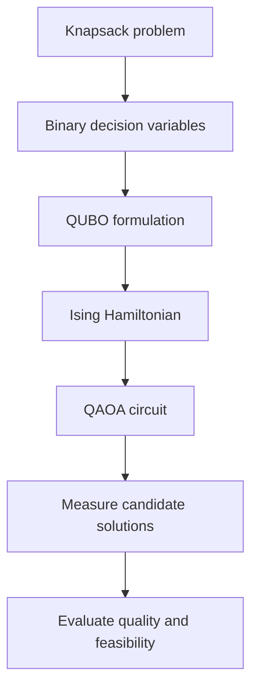

<div align="center">

# ◈KNAPSACK PS-3

### Five items. Two quantum processors. One optimization challenge.

*Exploring how qubit connectivity, circuit routing, and noise shape
the search for an optimal solution.*

**Qiskit Fall Fest 2026 · PS-O3 · Quantum Optimization**

</div>

---

## The challenge

A knapsack has a limited capacity. Each item has a weight and a value.
Choose a combination that maximizes the total value without exceeding
the capacity.

| Item | Value | Weight |
|:---:|---:|---:|
| A | 10 | 5 |
| B | 4 | 3 |
| C | 7 | 4 |
| D | 5 | 2 |
| E | 8 | 6 |

**Capacity:** 15

Our classical reference solution selects **A + B + C + D**,
with total weight **14** and total value **26**.

## From a combinatorial problem to qubits

Each item is represented by a binary decision:

- `1` — select the item
- `0` — leave the item out

The goal is to encode the optimization problem as a QUBO, translate
it into a quantum Hamiltonian, and investigate a QAOA-based approach.



## Two processor architectures

The same optimization problem can behave differently on different
connectivity maps.

| Architecture | Physical qubits | What we investigate |
|:---|:---:|:---|
| Processor A | 5 | Connectivity, routing and circuit cost |
| Processor B | 9 | Connectivity, routing and circuit cost |

A two-qubit operation can run directly only when the required qubits
are connected in the chosen architecture. Routing may require SWAP
operations, increasing circuit cost and potentially affecting results.

*Processor diagrams and routed-circuit comparisons will be generated
from the processor definitions used in the experiments.*

## What we measure

- **Solution quality:** how often the optimal solution is observed.
- **Feasibility:** how often measured solutions respect the capacity.
- **Circuit depth:** the number of sequential circuit layers.
- **Gate counts:** especially two-qubit gates such as CX.
- **SWAP overhead:** the additional routing cost imposed by connectivity.
- **Noise sensitivity:** how errors affect measured outcomes.

All reported benchmark values must come from executed experiments;
we will not fill result tables with assumed or illustrative numbers.

## The visual experience

This project aims to make quantum optimization easier to explore,
not just easier to read about.

- Processor maps that make qubit connectivity visible.
- Circuit diagrams that explain how operations are arranged.
- Clear, consistent comparisons between Processor A and B.
- Interactive charts where useful, backed by experimental data.

GitHub README supports rendered diagrams and images. Fully interactive
3D processor exploration can be linked from the README as a separate
web experience.

## Project structure

```text
qiskit-knapsack/
├── README.md
├── main.ipynb
├── requirements.txt
├── data/
│   ├── raw/
│   └── processed/
├── processors/
├── src/
├── results/
│   ├── tables/
│   └── figures/
└── report.md
```

## Reproducibility

The notebook, processor definitions, analysis code, and generated
results should work together as one reproducible experiment.
Exact software versions, simulation settings, random seeds, and
noise assumptions will be documented alongside the implementation.

## Team

**Qubit Crew** · SRM University–AP

*Qiskit Fall Fest 2026 — Phase 2*
